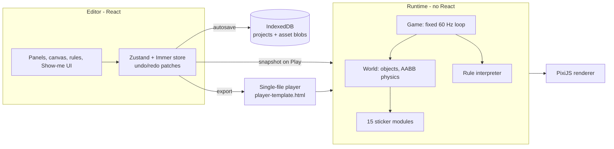

# StickWIX

A no-code 2D game maker for beginners (10+) that runs in a desktop browser and works offline. No accounts, no servers, no block coding. Games are made from three ideas:

1. **Stickers**: ready-made behaviours you stick onto a Kind of object (Platformer Controller, Solid, Collectible, Hurts Player, Patrol, Shooter… 15 in all), each tuned with a few sliders.
2. **Sentence rules**: logic written as a fill-in-the-blank sentence, e.g. _When [Hero] touches [any Coin] → [that Coin] disappears and [Score] goes up by [1]_. Every blank is picked from a menu.
3. **Show-me**: while playing, press **F2**, pick what just happened, act out what should happen in the frozen game, and StickWIX writes the rule.

Presets exist at every level: three starter games (Platformer, Top-down, Clicker), 24 object presets and 16 rule presets. A finished game exports as **one HTML file** that plays offline anywhere.

## Getting started

Requires Node 22 and pnpm.

```sh
pnpm install
pnpm dev          # builds the game-player template the first time, then http://localhost:5199
```

Open the page, take the guided tour (offered on first launch, or **Help → Guided tour**), or press **New game** and pick a starter.

## Scripts

| Script | What it does |
|---|---|
| `pnpm dev` | Editor dev server (port 5199). Builds `public/player-template.html` first if missing. |
| `pnpm build` | Player template, type check, then the editor into `dist/` (static files; host anywhere). |
| `pnpm build:player` | Single-file game player → `public/player-template.html`, fails if over 600 KB. |
| `pnpm test` | Unit and integration tests (Vitest, jsdom, fake IndexedDB, headless runtime). |
| `pnpm test:e2e` | End-to-end tests (Playwright, Chromium, one worker). `perf.spec.ts` runs headed to measure the real GPU. |
| `pnpm lint` / `pnpm typecheck` | ESLint (with layer rules) and strict TypeScript. |
| `pnpm assets` | Re-downloads and slices the built-in CC0 art and sound into `public/assets/builtin/`. |

One-off: `npx playwright install chromium` before the first `pnpm test:e2e`. `pnpm tsx scripts/make-stress-fixture.ts` regenerates the 200-object performance fixture.

## How it fits together



| Folder | Contents |
|---|---|
| `src/model/` | The project document: Zod schema (single source of truth), migrations, defaults, Kind/object override resolution, rule → English sentence, rule state (ok / incomplete / broken) and reference finding. |
| `src/runtime/` | The game engine, React-free and headless-testable: fixed-step loop, world and AABB/tile physics, sticker modules, rule interpreter (triggers, conditions, actions, scheduler, runaway guard), values, scenes, camera, screen UI layer, Web Audio, PixiJS renderer, `?fps` overlay. |
| `src/showme/` | Show-me: freeze session, intent log, generalisation (`any`/`that` Kind), intents → rule. |
| `src/lint/` | Common-mistake warnings. |
| `src/presets/` | Starter games, object presets, rule presets and copy-with-fresh-ids insertion. |
| `src/storage/` | IndexedDB, debounced autosave, single-writer tab lock, `.stickwix` project files, asset import limits. |
| `src/export/`, `src/player/` | Game export (assets inlined as data URLs) and the player that runs exported games. |
| `src/editor/` | The React editor: home, canvas, inspector, rules, values, screen layer, Show-me overlay, pixel editor, tour, help, warnings. |

ESLint forbids `runtime/`, `model/`, `showme/`, `lint/` and `player/` from importing editor code or React, so exported games stay small (the player template is about 592 KB).

Key behaviours: Play runs on a deep copy of the document, so Stop always restores the editor exactly; the simulation steps at a fixed 1/60 s regardless of display rate; rules run game → scene → Kind, each in list order; a rule chain that re-triggers itself more than 64 times in one moment is cut and flagged; at most 1,000 live objects per scene; objects more than one screen outside the scene are removed and fire "leaves the scene".

## Files

- **Projects** live in the browser's IndexedDB. Use **Export project file** (`.stickwix`, a zip of `project.json`, `meta.json` and `assets/`) to back up or move a game; **Import** on the home screen opens one as a new project. Invalid files are refused without changing anything.
- **Exported games** are a single `.html` file: no editor UI, letterboxed to the window, "Click to play" to start sound. "Remember between plays" values are kept in the player's `localStorage` by value name.
- **Your own art**: draw multi-frame sprites (8×8 to 128×128) in the pixel editor, or import PNG pictures (up to 2048×2048 and 5 MB) and WAV/MP3 sounds (up to 10 MB).

## Asset licences

Every built-in picture and sound is **CC0 1.0** (public domain), so exported games can be shared freely without attribution: Kenney's Pixel Platformer, Pixel Platformer Food Expansion, Tiny Dungeon, Tiny Town, UI Pack (Pixel Adventure), Interface Sounds, Impact Sounds, Digital Audio and Music Jingles (kenney.nl), and Juhani Junkala's "Chiptune Adventures" music (opengameart.org). A few small sprites (star, bullet, fireball, rock, cookie) were drawn for StickWIX and are also CC0. Sources, download URLs and per-file usage are listed in [`public/assets/builtin/LICENSE.txt`](public/assets/builtin/LICENSE.txt).

## Browser support

Latest desktop Chrome, Edge, Firefox and Safari, with mouse or trackpad and keyboard. Phones and tablets are not supported in this version.
